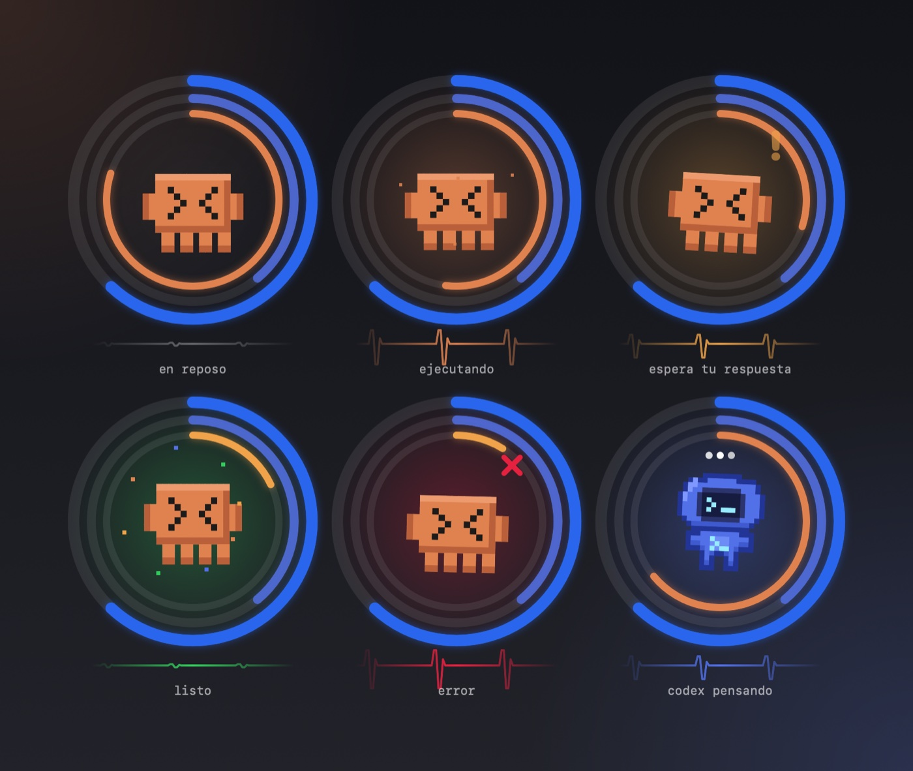

# Visto

Aprueba los permisos de Claude Code desde el iPhone y el Apple Watch, y mira a tus agentes trabajar en realidad aumentada. Es la app compañera de [claude pet](https://github.com/kisnner26/claude-pet) (Mac).



## qué hace

- **permisos con un toque**: permitir, denegar o «permitir siempre» (con confirmación y Face ID opcional). Lo de riesgo alto solo se puede denegar; aprobarlo exige estar en la Mac.
- **agentes en vivo**: estado de Claude y Codex, contexto restante, últimas acciones, consumo del plan de 5 horas y semanal, y las preguntas de Claude con opciones.
- **Isla Dinámica y pantalla bloqueada** con botones para decidir; atajos de Siri, botón de acción y Atajos.
- **Apple Watch**: la misma mascota con anillos, deslizar o Double Tap para decidir, girar la muñeca para denegar y pantalla siempre encendida tenue.
- **realidad aumentada**: las mascotas en 3D sobre tu mesa. Se tocan, se acarician, se arrastran, persiguen una pelota y celebran cuando un agente termina.
- **sentirse vivo**: sonidos sintetizados, háptica, voz opcional, destello de linterna y giroscopio. Español e inglés.

## cómo se conecta

claude pet escucha en tu red local y se anuncia por Bonjour (`_claudepet-visto._tcp`). No hay servidores ni cuentas. El canal va cifrado y autenticado (ChaCha20-Poly1305) con una clave que sale de un código de 12 caracteres que se escribe, o se escanea, una sola vez. Cambiar el código desconecta todos los dispositivos. Desde fuera nunca se aprueba nada de riesgo alto y el perímetro y las reglas ya se aplicaron en la Mac.

## compilar

Necesita Xcode 26 y [XcodeGen](https://github.com/yonaskolb/XcodeGen).

```sh
xcodegen generate
xcodebuild -project Visto.xcodeproj -scheme Visto -destination 'generic/platform=iOS' CODE_SIGNING_ALLOWED=NO build
xcodebuild -project Visto.xcodeproj -scheme VistoWatch -destination 'generic/platform=watchOS' CODE_SIGNING_ALLOWED=NO build
```

Para instalar en tus dispositivos define `VISTO_TEAM_ID` con tu equipo de desarrollo y firma. Con el perfil gratuito de Apple caduca a los 7 días y solo caben tres apps por dispositivo.

`VistoCore` (el protocolo cifrado, el emparejado y el cliente) es un paquete de Swift que también usa claude pet; se prueba con:

```sh
cd VistoCore && swift test
```

## estructura

| carpeta | qué hay |
|---|---|
| `Phone` | app del iPhone: pantallas, sensaciones, realidad aumentada, Isla Dinámica |
| `Watch` | app del Apple Watch |
| `Live` y `LiveShared` | actividad en vivo y widgets |
| `Intents` | atajos de Siri y botón de acción |
| `Shared` | mascotas en píxeles, tema y llavero |
| `VistoCore` | protocolo, emparejado, canal cifrado, host y cliente |

Licencia MIT. La mascota y el arte en píxeles son de claude pet.
